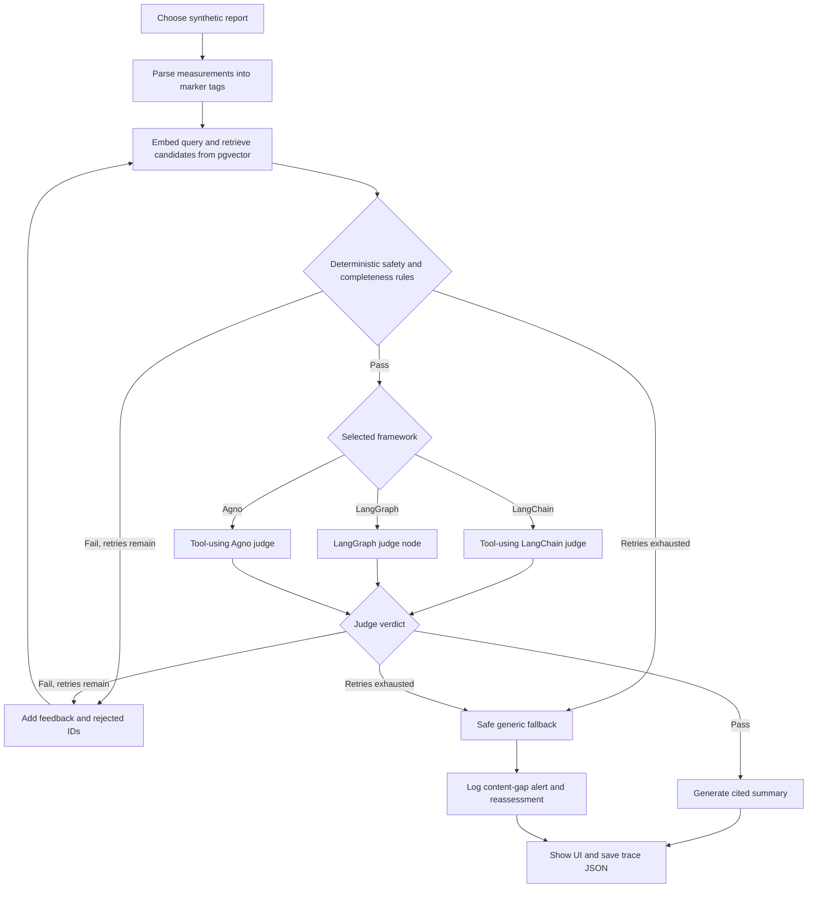

# POC 2 — Well-being Recommender: Agent Framework Comparison

POC2 compares three ways to build an agent-style review loop over the same synthetic wellness content:

1. **LangChain:** tool-using agent with structured Pydantic output reviews article relevance.
2. **LangGraph:** explicit state graph with visible nodes, retries, conditional edges, and fallback.
3. **Agno:** tool-using agent with a Pydantic verdict reviews article relevance.

All three use a shared Python retrieval/rules layer, the OpenAI API, and a separate PostgreSQL/pgvector database. The Streamlit UI runs the same report with any selected framework.

> Educational software only, not a medical or clinical system. Use only the bundled synthetic reports. Report notes and retrieved article text are sent to OpenAI; never use real health or personal data.

## Implementation summary

- **Data:** independent copy of POC1's 30 synthetic articles plus three generic defaults, using `vendor` and fictional `Everwell` sources; three sample reports include a hypertension safety case and a deliberate postpartum content gap.
- **Retrieval:** OpenAI `text-embedding-3-small` creates 1536-dimensional article/query embeddings. pgvector ranks approved, non-default articles by cosine distance and filters by category. To demonstrate maker-checker behavior, retrieval intentionally allows contraindicated candidates through to the deterministic validator.
- **Safety:** Python rules reject unapproved/default candidates, wrong categories, contraindication overlaps, high-intensity physical recommendations for hypertension, incomplete category counts, and unmatched report topics. The LLM cannot override rule failures.
- **Agent check:** only when deterministic rules pass, LangChain/Agno use an article-reading tool with structured output; LangGraph runs a structured OpenAI judge node. Judges receive article text and condition tags. They assess topic coverage across the selected article set, not by requiring every article to address every report marker. A failed verdict can trigger at most three retries after the initial attempt.
- **Fallback:** if validation still fails, show the approved generic physical and mental defaults, explain that they may not fit, add `postpartum`/other uncovered topics to `output/content_gap_alerts.jsonl`, and add the case to `output/reassessment_queue.jsonl`.
- **UI and CLI:** Streamlit offers framework/report selectors, recommendation scores, traces, fallback status, and summaries. The CLI runs one framework/report. Every run saves a separate JSON result and trace.

## Plain-language flow

An agent workflow here works like a small team:

- The **retriever** finds possible articles from the database. It does not make the safety decision.
- The **rules checker** is the strict checklist. It rejects disallowed articles before any language-model judgment.
- The **judge agent** reads the article text and checks whether it actually matches the report's topics. This is a judgment task, not a safety authority.
- The **retry loop** passes feedback to retrieval and avoids rejected article IDs, up to three retries.
- The **fallback** avoids presenting rejected recommendations as suitable when the loop cannot find a passing set.

R2 makes the separation visible: the retriever may surface a hypertension-contraindicated/high-intensity article; deterministic rules reject it, and a later attempt must use safer candidates. R3 has no postpartum article, so topic coverage fails on each attempt and the system falls back rather than pretending a nearest-neighbor match is relevant.

The judge treats normalized report markers as topics (for example, `poor_sleep` means fewer than six hours of sleep, and `high_bmi` means BMI of 30 or higher). It evaluates the candidates collectively: an article can be relevant to one marker while another article covers a different marker. Article titles and body text are the primary evidence; `condition_tags` are relevance metadata that help interpret the match, not a replacement for relevant content. This avoids rejecting a useful recommendation merely because it does not individually cover every marker, while still failing closed when the set leaves a marker or an unmatched report topic uncovered.

## Workflow diagram



The LangGraph version represents this diagram directly as a `StateGraph`. LangChain and Agno use their agent/tool abstractions for the semantic article review; a shared bounded Python loop keeps their safety rules and retry limits comparable.

## Setup in Codespaces

Run commands from `poc2-wellbeing-agent/`:

```bash
python3 -m venv .venv
source .venv/bin/activate
python -m pip install -r requirements.txt
cp .env.example .env
docker compose up -d db
python -m src.agent_app --setup-db
python -m src.agent_app --seed
```

The included deterministic article generator can recreate the same source snapshot:

```bash
python scripts/generate_seed_data.py
```

Set `OPENAI_API_KEY` as a Codespaces secret and restart the Codespace. Do not commit a real key or place it in output. POC2 uses host port 5433, separate from POC1's 5432 database.

Check configuration:

```bash
python -m src.agent_app --preflight
```

Generate article embeddings:

```bash
python -m src.agent_app --ingest
```

The default model pair is `gpt-4o-mini` and `text-embedding-3-small`. API calls incur usage charges and may be rate limited; each framework can consume a different number of calls depending on retries and whether validation passes. Model access is checked when a request is made.

## Run the Streamlit comparison UI

```bash
streamlit run src/streamlit_app.py --server.address 0.0.0.0 --server.port 8502
```

Forward port **8502** in the Codespaces **Ports** panel and keep it **Private**. Choose R1, R2, or R3; choose LangChain, LangGraph, or Agno; then click **Run agent**. Each run calls external models and saves a trace to `output/runs/<report_id>_<framework>.json`.

## Run one case from the CLI

```bash
python -m src.agent_app --report reports/report1_happy_path.json --framework langgraph
python -m src.agent_app --report reports/report2_safety_trap.json --framework langchain
python -m src.agent_app --report reports/report3_content_gap.json --framework agno
```

Framework choices are `langchain`, `langgraph`, and `agno`. The result/trace is saved under `output/runs/`.

## Expected outcomes

- **R1 happy path:** eligible articles should pass deterministic checks and receive a semantic relevance review; a passing run contains three physical and three mental articles, generates a summary, and does not use fallback. Retries may vary with model judgments.
- **R2 safety trap:** an unsafe/high-intensity candidate should be rejected by the deterministic checker; retrieval retries without rejected IDs. Final output must contain no contraindicated or high-intensity physical article.
- **R3 content gap:** `postpartum` is extracted as an unmatched topic; the rule checker fails closed, three retries occur, then approved generic physical and mental defaults are shown. An alert and reassessment entry are appended.

LLM judgments and similarity scores may vary with model behavior. Retry count is bounded and safety rules are deterministic. The fallback is not personalized health guidance.

For a quick end-to-end check after setup and ingestion, run R1 with LangGraph:

```bash
python -m src.agent_app --report reports/report1_happy_path.json --framework langgraph
python -m json.tool output/runs/R1_langgraph.json
```

Confirm `used_fallback` is `false`, there are three articles in each category, the trace contains a passing `llm_judge` event, and the summary is non-empty. This command calls OpenAI and may incur usage charges. Run the other framework/report combinations from the CLI examples above to compare their traces; R2 and R3 exercise safety retry and fallback behavior.

## Inspecting traces and alerts

Trace JSON includes report ID, framework/model names, marker tags, unmatched topics, retry count, recommendation candidates, final summary, and per-step trace entries with elapsed time. Each trace entry records the attempt, node, article IDs, verdict/reason, and elapsed time.

```bash
python -m json.tool output/runs/R2_langgraph.json
cat output/content_gap_alerts.jsonl
cat output/reassessment_queue.jsonl
```

Output JSONL and run files are gitignored. Do not put sensitive data in these records.

## Tests

Tests exercise parser and deterministic safety rules, retry-to-pass behavior, R3 fallback/alert logging, and the 33-item synthetic dataset without a database or API key:

```bash
python -m pytest -q
```

Framework packages are installed independently in this POC's `.venv`, so they do not alter POC1 dependencies.

## Framework comparison

| Framework | What to observe | Agent implementation |
|---|---|---|
| LangChain | Tool invocation and structured validator output | `src/agents/langchain_agent.py` |
| LangGraph | Explicit nodes, state, retry edge, and fallback edge | `src/agents/langgraph_agent.py` |
| Agno | Tool invocation and Pydantic output schema | `src/agents/agno_agent.py` |

All three share the same retrieval index, report parser, deterministic checks, retry budget, and fallback so the comparison focuses on framework orchestration rather than different data or rules. Agent retries cost more calls and add latency; fixed RAG is enough when deterministic filtering plus a grounded summary meets the use case, while an agent loop is useful when iterative checking and explicit recovery behavior justify the added cost.

## Stop or reset the database

```bash
docker compose down
```

This retains the named volume. To intentionally erase POC2's local database and seeded data, use `docker compose down -v`, then repeat setup and seeding. Do not expose PostgreSQL publicly.
